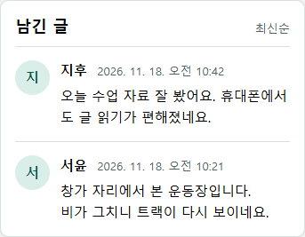

[실습 페이지](https://github.com/gbox3d/teaching_repo/tree/main/web_programming/weeks/week07_form_input)

# 7주차 CSS 응용

4주차에 익힌 색상·여백·반응형 배치를 실제 화면에 적용한다. 1일차에는 W3.CSS 클래스로 카드와 메뉴를 꾸미고 짧은 글을 최신순으로 읽는 타임라인을 살펴본다. 2일차에는 같은 배치를 방명록에 적용한다. 매일 강의·시연 60분과 실습 30분이다.

방명록의 JavaScript는 제공한다. 글을 등록한 뒤 작성자와 시각이 본문과 구분되는지, 여러 줄로 쓴 글과 긴 단어가 좁은 화면에서도 읽히는지 확인한다.

## 예제 바로 실행

Node.js가 설치된 PC에서 교재 저장소의 맨 위 폴더(`web_programming`이 보이는 위치)를 터미널로 연다. Windows PowerShell과 macOS 터미널에서 같은 명령을 쓴다.

```sh
node web_programming/tools/static-server/server.mjs web_programming/weeks/week07_form_input 8000
```

서버를 실행한 채로 아래 예제를 연다. 두 화면을 모두 확인한 뒤 터미널에서 `Ctrl+C`로 서버를 종료한다.

| 예제 | 확인할 동작 |
|---|---|
| [1일차 수업 타임라인 열기](http://localhost:8000/examples/day1/ex03b_list/index.html) | **새 글 1개 보기**를 누르면 박준호의 10:35 글 위에 김민서의 10:42 글이 나타난다. |
| [2일차 완성 방명록 열기](http://localhost:8000/examples/day2/web-week07/guestbook.html) | 이름을 `student01`로 쓰고 메시지 ‘첫 글’과 ‘둘째 글’을 차례로 남긴다. ‘둘째 글’이 맨 위에 보여야 한다. |

## 학습 목표

- 색상·여백·테두리 클래스를 조합해 메뉴, 카드, 버튼의 역할을 구분한다.
- 375px와 1280px에서 메뉴 배치를 비교하고, 좁은 화면에서 긴 글이 가로로 넘치지 않게 한다.
- 작성자와 시각을 본문 위에 배치하고 글 사이에 여백과 구분선을 두어 한 글의 시작과 끝이 보이는 피드를 구성한다.
- 제공된 JavaScript가 사용하는 `id`를 유지하면서 스타일을 바꾸고 새 글이 맨 위에 표시되는지 확인한다.

## 2일 수업 흐름

| 일차 | 강의·시연 60분 | 실습 30분 |
|---|---|---|
| 1일차 | CDN과 CSS 클래스 10분 → ex01 연결 전후 15분 → ex02 입력창·버튼 15분 → ex03 카드·메뉴 7분 → ex03b 타임라인 8분 → 확인 5분 | CDN 확인 5분 → 입력창·버튼 변경 5분 → 메뉴·카드 확인 5분 → 피드 여백·화면 폭 비교 10분 → 결과 점검 5분 |
| 2일차 | ex04 실행 10분 → 제공 JS 읽기 10분 → ex05 입력 폼 변환 10분 → 메뉴·피드 배치 10분 → 같은 JS와 `class`·`id` 확인 10분 → 동작·모바일 검증 10분 | CDN 교체 5분 → 클래스 적용·색상 변경 13분 → 동작·375px 점검 7분 → 캡처 5분 |

다운로드, 새 저장소 생성, Git 설정은 수업 전에 준비하고, push와 Pages 확인은 수업 뒤에 진행한다. 수업 중 실습 시간은 화면 변경과 실행 확인에 쓴다.

각 차시 첫 5분은 첫 10분 구간 안에서 파일·서버 준비 상태를 확인한다. 마지막 5분에는 결과 확인과 함께 다음 실습·수업을 안내한다. ex01~ex05는 강의자 비교 시연이며, 학생은 1일차에 ex02·ex03의 클래스와 ex03b의 글 사이 여백, 2일차에 제공 시작 파일의 CDN·매핑 클래스·색상 한 곳을 수정한다. 제공 JS 재작성과 추가 기능은 필수가 아니다.

## 수업 전 준비

VS Code, Chrome, Git, 인터넷 연결을 준비한다. 제공 파일로 `web-week07` 작업 폴더를 만들고 이번 주 `examples/`를 폴더 구조 그대로 가져온다. `guestbook.before.html`을 `guestbook.html`로 복사하여 변환 전 방명록에서 시작한다. [따라하기](walkthrough.md#수업-전-준비)에 준비 순서가 있다. CDN을 읽으려면 인터넷 연결이 필요하다.

W3.CSS는 다음 주소를 `<head>`에 연결한다. 라이브러리 파일을 저장소에 내려받지 않는다.

```html
<link rel="stylesheet" href="https://cdnjs.cloudflare.com/ajax/libs/w3-css/4.1.0/w3.min.css">
```

ex02·ex03의 입력과 미리보기는 W3.CSS 클래스로 꾸민다. ex03b에서는 `shared/examples.css`를 열어 타임라인의 여백을 바꾼다. 2일차 방명록은 같은 이름의 파일에서 피드 배치를 확인한다. ex04는 변환 전 비교를 위해 `../web-week07/styles.css`도 읽고, W3.CSS 예제와 완성본 방명록은 위 CDN을 읽는다. 완성본의 홈·소개 페이지는 기존 `styles.css`를 사용한다.

## 예제와 변경 범위

| 예제 | 관찰할 내용 | 학생이 바꿀 내용 |
|---|---|---|
| [ex01](examples/day1/ex01/README.md) | `before.html`과 `index.html`의 CDN 연결 전후, 같은 버튼 동작 | CDN 확인, 색상 변경은 시연·선택 |
| [ex02](examples/day1/ex02/README.md) | `w3-input`, `w3-border`, `w3-button`을 적용한 입력 미리보기 | 버튼 색상 또는 입력창 테두리 |
| [ex03](examples/day1/ex03/README.md) | 카드·컨테이너·메뉴, `w3-mobile`의 화면 폭에 따른 배치 | 메뉴 색상 또는 카드 여백 |
| [ex03b 타임라인](examples/day1/ex03b_list/README.md) | 작성자·시각·본문과 글 사이 구분선 | 글 사이 여백 변경, 375px·1280px 비교 |
| [ex04](examples/day2/ex04/README.md) | 기존 CSS로 만든 동작하는 방명록 | 제공 JS를 읽고 동작 확인 |
| [ex05](examples/day2/ex05/README.md) | ex04와 같은 JS를 쓰는 W3.CSS 방명록 | 클래스 적용 전후 비교 |
| [web-week07](examples/day2/web-week07/) | 변환 전 시작 파일과 변환 후 대조 파일 | 시작 파일의 CDN·클래스 변경, 색상 한 곳 변경 |

## 화면 요소별 CSS

| 범주 | 대표 클래스 | 적용 위치 |
|---|---|---|
| 입력창과 버튼 | `w3-input`, `w3-border`, `w3-button` | 이름·메시지 입력, 남기기 버튼 |
| 색상과 여백 | `w3-teal`, `w3-blue`, `w3-padding` | 제목·버튼·카드 내부 |
| 카드와 컨테이너 | `w3-container`, `w3-content`, `w3-card` | 화면 내용과 입력 영역 |
| 타임라인 | `.feed-list`, `.post`, `.post-body` | 작성자·시각·본문 정렬, 글 사이 여백과 구분선 |
| 메뉴와 모바일 배치 | `w3-bar`, `w3-bar-item`, `w3-mobile` | 메뉴 항목과 좁은 화면 |

`class`에는 공백으로 여러 클래스를 붙일 수 있다. 이 예제의 `w3-*` 클래스는 스타일을 정하고, `id`는 JavaScript가 요소를 찾는 데 쓴다. 이 구분은 이번 예제의 사용 방식이며 CSS도 `id`를, JavaScript도 `class`를 선택자로 사용할 수 있다.

### 방명록 피드



왼쪽 열에는 아바타를 두고 오른쪽 열에는 작성자, 시각, 본문을 놓는다. `minmax(0, 1fr)`로 오른쪽 열이 화면 폭에 맞게 줄어들도록 한다. 본문의 `white-space: pre-wrap`은 학생이 넣은 줄바꿈을 보존하고, `overflow-wrap: anywhere`는 긴 단어도 화면 안에서 나눈다.

### 화면이 예상과 다를 때

| 증상 | 확인할 곳 |
|---|---|
| 타임라인의 글 사이 여백을 바꿔도 그대로다. | [타임라인 CSS](examples/day1/ex03b_list/shared/examples.css)에서 `.post`의 `padding-block` 값을 바꿨는지 확인한다. 저장하고 새로고침한 뒤 개발자 도구의 Elements에서 `article.post`를 선택해 적용된 값을 본다. |
| 방명록 버튼 색상은 보이지만 아바타와 본문이 한 줄에 나란히 놓이지 않는다. | 개발자 도구의 Network를 열고 새로고침한다. `shared/examples.css`가 404이면 방명록 HTML과 같은 폴더에 `shared/`를 복사한다. 버튼 색상까지 빠졌다면 CDN의 `w3.min.css` 요청도 확인한다. |
| 방명록에서 둘째 글이 첫 글 아래에 붙는다. | Elements에서 `ul#list`의 첫 번째 `li`를 확인한다. 첫 번째 `li`가 ‘첫 글’이면 [제공 JS](examples/day2/web-week07/guestbook.js)의 `list.prepend(li)`와 내 코드를 비교한다. |

## 제공 JavaScript 읽기

ex04와 ex05의 `app.js`, 완성본의 `guestbook.js`는 같은 코드다. JavaScript를 다시 작성하는 대신 아래 흐름을 코드에서 찾고 실행 결과와 연결한다.

| 코드 | 방명록에서 하는 일 |
|---|---|
| `submit` · `event.preventDefault()` | 폼 제출을 받고 페이지가 다시 열리는 기본 동작을 막는다 |
| `.value.trim()` | 제출 시 입력값을 읽고 앞뒤 공백을 제거한다 |
| 빈값 검사 · `return` | 빈 입력을 안내하고 목록 추가 전에 함수를 끝낸다 |
| `textContent` · `prepend` | 작성자와 본문을 글자로 표시하고 새 항목을 목록 맨 앞에 넣는다 |
| `form.reset()` · `focus()` | 입력을 초기값으로 되돌리고 이름 칸으로 커서를 옮긴다 |
| `input` · `clearNotice` | 다시 입력하면 안내 문구를 지운다 |

제공된 입력 칸의 초기값은 비어 있으므로 `reset()` 뒤에 칸이 빈다. 이메일은 선택 입력이며 현재 JS는 이름과 메시지만 읽는다. 이메일을 입력하면 브라우저가 `type="email"` 형식을 먼저 검사한다. 형식이 틀리면 JS의 submit 처리 전에 제출을 막으므로, 기본 실습에서는 비워 두거나 `student01@example.com`을 쓴다. 새로고침하면 목록이 사라진다. 저장 기능은 11주차에 다룬다.

## 완료 기준과 제출

- CDN 요청이 성공하고 Console에 예제 코드 오류가 없다.
- 빈 입력은 안내하고, 글 두 건을 등록하면 두 번째 글이 첫 번째 글 위에 표시된다. 입력 후 칸이 비고 이름 칸에 커서가 있다.
- 버튼이나 제목의 색상을 바꾸고, 375px에서 메뉴·작성자·시각·여러 줄 본문이 가로로 넘치지 않는지 확인한다.
- 주소와 글 두 건이 보이는 375px 실행 화면 한 장을 제출한다. 색상 변경이 같은 화면에 보이면 된다. 비교표나 코드 전문은 제출하지 않는다.

공개 저장소와 캡처에는 `student01` 같은 예시 이름을 쓴다. 제출 방법은 [실습지](lab.md#제출--캡처-한-장)에 있다.

## 수업 자료

- [슬라이드](slides.md) · [English slides](slides_en.md) · [교재 사이트 덱](https://gbox3d.github.io/teaching_repo/webprg/decks/week07_form_input/index.html)
- [실습과 제출 안내](lab.md) · [순서대로 따라하기](walkthrough.md) · [예제 설명](examples/README.md)
- [변환 전 시작 HTML](examples/day2/web-week07/guestbook.before.html) · [완성본 HTML](examples/day2/web-week07/guestbook.html) · [제공 JS](examples/day2/web-week07/guestbook.js)
- [정적 서버](../../tools/static-server/server.mjs) · [서버 사용 안내](../../tools/static-server/README.md)

## 다음 수업 연결

8주차 중간 실기에서는 [문제 은행](../week08_midterm/examples/README.md)으로 앞선 수업을 확인한다. 출제 범위와 연습 항목은 문제 은행과 분반 안내에서 확인한다. 9주차는 시험 답안 대신 `web-week07` 완성본에서 시작하며 웹 파일을 유지한 채 README·캡처·SVG를 더한다. 10주차에는 배열로 목록을 관리한다. 11주차 필수 실습은 폼 한 건 저장·복원이며, 전체 저장 방명록은 제공 시연본이다.

## 참고 자료

- [cdnjs W3.CSS 4.1.0](https://cdnjs.com/libraries/w3-css)
- [W3.CSS 입력창](https://www.w3schools.com/w3css/w3css_input.asp)
- [W3.CSS 컨테이너](https://www.w3schools.com/w3css/w3css_containers.asp)
- [W3.CSS 카드](https://www.w3schools.com/w3css/w3css_cards.asp)
- [W3.CSS 탐색 메뉴](https://www.w3schools.com/w3css/w3css_navigation.asp)
- [W3.CSS 반응형 화면](https://www.w3schools.com/w3css/w3css_responsive.asp)
