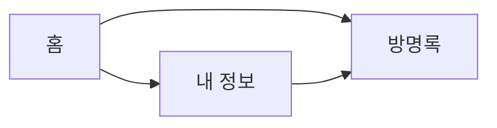

<!-- ex11 Mermaid: 좌표 없이 연결만 글자로 적으면 GitHub 이 도표로 그려 준다 -->
<!-- 1·2번은 내용이 같고 여는 줄의 언어 이름만 다르다. 올린 뒤 GitHub 화면에서 본다 -->

1번 — 언어 이름 mermaid. 화살표(-->)가 연결이다:



2번 — 같은 내용. 언어 이름이 text 다:

```text
flowchart LR
  home[홈] --> about[내 정보]
  home --> guestbook[방명록]
  about --> guestbook
```
