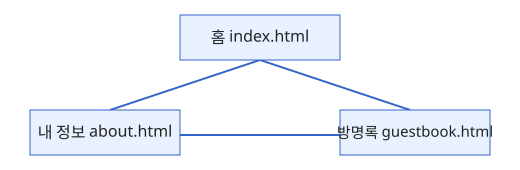
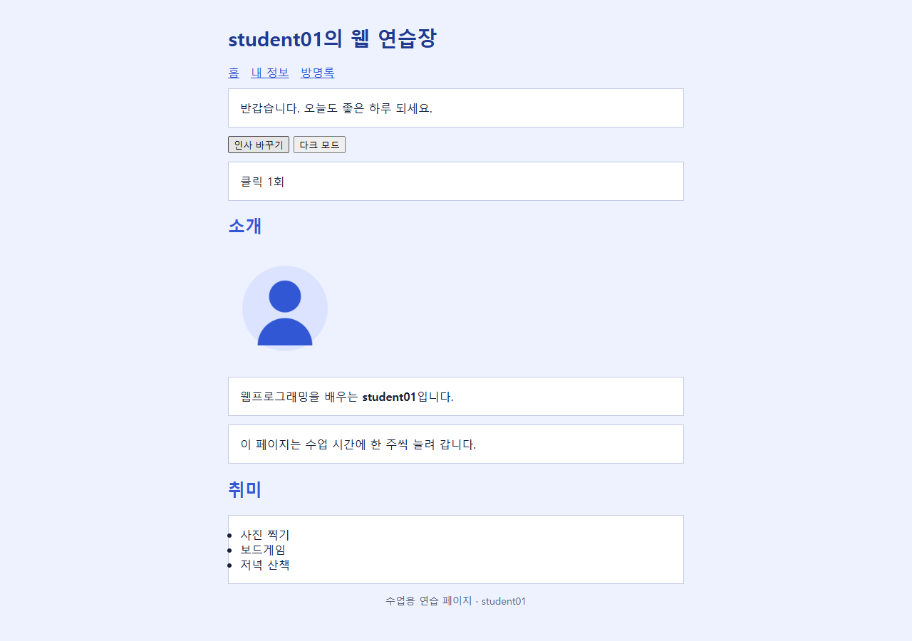
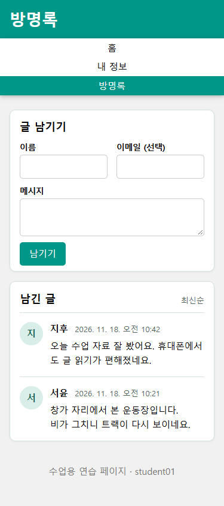

# TODO: 내 사이트 이름

TODO: 사이트 소개 한 문장

## 공개 주소

- [내 사이트](https://TODO.github.io/web-week09/)

## 페이지

| 페이지 | 파일 | 내용 |
|---|---|---|
| 홈 | [index.html](index.html) | 인사말과 버튼 |
| 내 정보 | [about.html](about.html) | 수업용 가상 정보 |
| 방명록 | [guestbook.html](guestbook.html) | 이름·메시지 입력 |



## 기능

- TODO: 홈 버튼이 하는 일
- TODO: 방명록 폼이 하는 일

```js
// TODO: 내 app.js의 다크 모드 이벤트 함수를 복사한다.
```

## 화면





## 이번에 배운 것

- TODO: HTML에서 한 일
- TODO: CSS에서 한 일
- TODO: JavaScript에서 한 일
