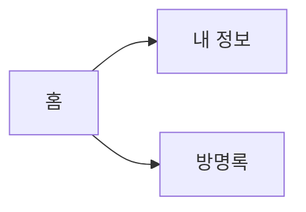

# 마크다운과 1차 과제 발표

1일차는 **마크다운 기본 기능**을 하루 동안 봅니다. 2일차는 1차 과제 2분 발표입니다.

```text
1일차   제목 · 목록 · 링크 · 강조 · 그림 · 소스 코드 · 표 · 인용 · SVG 도표 · Mermaid
        → 3~7주 사이트를 소개하는 README.md 1차판
2일차   공개 주소 → 세 페이지 → 버튼·폼 → README·Commits 탭 (2분)
```

- 저장소는 새 저장소 `web-week09`, 사이트 파일은 7주차 완성본 그대로입니다.
- 배점은 **10점**(발표 5 + 레포트 5)입니다. 주차별 실습 점수 대상은 아닙니다.

---

# 1일차 — 마크다운 기본 기능과 README 1차판

`30분 설명·시연 → 60분 실습`

1. ex01 제목과 미리 보기 · ex02 목록 · ex03 링크
2. ex04 강조
3. ex05 그림
4. ex06 소스 코드
5. ex07 표 · ex08 인용과 구분선
6. ex09 SVG 그림 · ex10 SVG 도표 · ex11 Mermaid
7. 조립 — `web-week09` 맨 위의 `README.md`

---

## 1일차 · 0–5분 — ex01 제목: 샵 개수와 띄어쓰기

[examples/day1/ex01_heading.md](examples/day1/ex01_heading.md)

```text
원문              렌더된 모양
# 공개 주소       공개 주소       ← 1. 샵 하나: 가장 큰 제목
## 공개 주소      공개 주소       ← 2. 샵 둘: 한 단계 작은 제목
#공개 주소        #공개 주소      ← 3. 띄어쓰기 없음: 보통 글자
```

- 마크다운은 기호로 쓰는 글이고, **렌더**는 그 기호를 읽어 모양으로 그리는 것입니다.
- VS Code 에서 **Ctrl+K** 다음 **V** — 원문 옆에 미리 보기가 열립니다.

**줄 맨 앞 `#` 개수가 제목의 크기다. `#` 뒤에는 띄어쓰기 한 칸.**

---

## 1일차 · 5–8분 — ex02 목록: 점·번호·안쪽·점검표

[examples/day1/ex02_list.md](examples/day1/ex02_list.md)

```text
- 홈              • 홈                ← 1. 점 목록
홈 / 내 정보      홈 내 정보          ← 2. 기호 없으면 한 문단으로 이어짐
-홈               -홈                 ← 3. 띄어쓰기 없음: 글자 그대로
1. 홈             1. 홈               ← 4. 번호 목록
  - 이름 칸         ◦ 이름 칸         ← 5. 두 칸 들여 쓰면 안쪽 목록
- [x] 공개 주소   ☑ 공개 주소         ← 6. 점검표
```

- 빈 줄이 문단을 나눕니다. 원문에서 줄만 바꾸면 이어집니다.

**줄 맨 앞의 `- ` · `1. ` 이 목록 한 줄을 만든다.**

---

## 1일차 · 8–10분 — ex03 링크: 대괄호는 보이는 글, 소괄호는 갈 곳

[examples/day1/ex03_link.md](examples/day1/ex03_link.md)

```text
[MDN 웹 문서](https://developer.mozilla.org/ko/)   ← 1. 인터넷 주소
[ex01 제목 예제](ex01_heading.md)                  ← 2. 같은 폴더의 파일
[ex01 제목 예제] (ex01_heading.md)                 ← 3. 2번과 한 칸 차이: 링크 아님
```

- 파일 이름은 대소문자까지 같게 씁니다. GitHub 은 `Home.png` 와 `home.png` 를 다른 파일로 봅니다.

**같은 저장소 안의 파일은 소괄호에 이름(경로)만 쓴다.**

---

## 1일차 · 10–12분 — ex04 강조: 굵게·기울임·취소선

[examples/day1/ex04_emphasis.md](examples/day1/ex04_emphasis.md)

```text
**세 페이지**        세 페이지(굵게)            ← 1
*세 페이지*          세 페이지(기울임)          ← 2
~~세 페이지~~        세 페이지(취소선)          ← 3
**[남기기]**를       **[남기기]**를 (별이 남음)  ← 4. 문장 부호 + 조사가 바로 붙음
**[남기기]** 를      [남기기](굵게) 를           ← 5. 한 칸 띄우면 된다
```

- 한글 문서에서 자주 만나는 함정이 4번입니다. 오류 없이 별이 글자로 남습니다.

**같은 기호로 앞뒤를 감싼다. 별이 보이면 닫는 별 뒤를 한 칸 띄운다.**

---

## 1일차 · 12–15분 — ex05 그림: 링크 앞에 느낌표

[examples/day1/ex05_image.md](examples/day1/ex05_image.md)

```text
      ← 1. 그림이 문서 안에 보인다
[대신 읽을 글](images/profile.png)       ← 2. 느낌표 없음: 그림으로 가는 링크
       ← 3. 경로 틀림: 그림 대신 글자
        ← 4. 크기를 정할 때는 img 태그
```

- 대괄호 글자는 3주차 `alt` 와 같습니다. 그림이 안 보일 때 대신 나옵니다.
- 경로는 3주차 `images/profile.png` 와 같습니다. 이 파일 기준으로 찾습니다.

**`!` 하나가 링크를 그림으로 바꾼다.**

---

## 1일차 · 15–18분 — ex06 소스 코드: 백틱

[examples/day1/ex06_code.md](examples/day1/ex06_code.md)

````text
문장 안에서 `querySelector` 를 쓴다.    ← 1. 백틱 하나: 짧은 코드

```js                                    ← 3. 여는 줄에 언어 이름: 색이 입혀진다
button.addEventListener('click', …);
```                                      ← 닫는 줄을 빠뜨리면 뒤가 전부 코드가 된다
````

- 2번은 언어 이름이 없어 코드가 한 색입니다. `js`·`html`·`css`·`bash` 를 씁니다.
- 4번: 코드 블록 안의 `#`·`-` 는 제목·목록이 되지 않습니다.

**여러 줄 코드는 백틱 세 개 줄 사이에, 여는 줄에 언어 이름.**

---

## 1일차 · 18–21분 — ex07 표 · ex08 인용과 구분선

[examples/day1/ex07_table.md](examples/day1/ex07_table.md) · [examples/day1/ex08_quote_rule.md](examples/day1/ex08_quote_rule.md)

```text
| 페이지 | 파일 |          ← 첫 줄이 머리글
|---|---|                  ← 구분 줄. 빠지면 표가 아니라 글자
| 홈 | index.html |        ← 내용
|:---|:---:|---:|          ← 콜론 자리: 왼쪽 · 가운데 · 오른쪽 정렬

> 새로고침하면 사라진다.   ← 인용
---                        ← 위가 빈 줄이면 가로줄, 글 바로 아래면 그 글이 제목
```

**표는 구분 줄이 있어야 표다.**

---

## 1일차 · 21–25분 — ex09·ex10 SVG: 글자로 그리는 그림과 도표

[ex09_svg.md](examples/day1/ex09_svg.md) · [ex09_shapes.svg](examples/day1/ex09_shapes.svg) · [ex10_diagram.md](examples/day1/ex10_diagram.md) · [ex10_site_map.svg](examples/day1/ex10_site_map.svg)

```text
<rect x="20" y="20" width="120" height="60" fill="#e8f1ff" stroke="#3366cc"/>
<line x1="140" y1="50" x2="260" y2="50" stroke="#3366cc"/>
<text x="20" y="120" font-size="20">글자</text>

        ← 문서에는 그림처럼 넣는다
```

- 숫자는 자리와 크기입니다. 파일을 고치고 저장하면 미리 보기 그림이 바뀝니다.
- 문서 안에 `<svg>` 를 바로 적으면 GitHub 이 지웁니다(ex09 2번). **파일로** 넣습니다.
- 배경 사각형을 흰색으로 깔아야 GitHub 어두운 화면에서도 글자가 보입니다.

**SVG 는 글자로 적은 그림이다. 사각형·선·글자면 도표가 된다.**

---

## 1일차 · 25–27분 — ex11 Mermaid: 연결만 적으면 도표

[examples/day1/ex11_mermaid.md](examples/day1/ex11_mermaid.md)

````text

````

- SVG 는 자리를 직접 정하고, Mermaid 는 **연결만** 적으면 GitHub 이 자리를 잡아 그립니다.
- VS Code 기본 미리 보기에서는 코드로 보일 수 있습니다. 올린 뒤 GitHub 화면에서 봅니다.

**자리까지 정하려면 SVG, 빨리 그리려면 Mermaid.**

---

## 1일차 · 27–30분 — 조립: README 1차판, 그리고 실습 인계

```text
# 사이트 이름 · 소개 문장(**굵게**)          ← ex01 · ex04
## 공개 주소   - [주소](주소)                ← ex02 · ex03
## 페이지      표 +   ← ex07 · ex10
## 기능        - 두 줄 + ```js 코드 블록     ← ex02 · ex06
## 화면         두 장  ← ex05
## 이번에 배운 것  - 세 줄                   ← ex02
```

[1일차 실습](lab.md#1일차--마크다운-기본-기능과-readme-1차판-60분) · [따라하기](walkthrough.md#1일차) · [실습 페이지](https://github.com/gbox3d/teaching_repo/tree/main/web_programming/weeks/week09_readme_presentation)

값 바꿔 보기(35분까지) → 캡처·도표·README 조립(50분까지) → 새 저장소 `web-week09` · Pages · 저장소 첫 화면 캡처 1장(제출).

**설명 합계: 5+3+2+2+3+3+3+4+2+3 = 30분**

---

# 2일차 — 2분 발표

`30분 안내 → 60분 발표`

1. 오늘 순서와 탭 세 개
2. 채점표 10점
3. 2분 시연 한 번 보기
4. 공개 주소가 안 열리면
5. 질문과 발표 시작

---

## 2일차 · 0–6분 — 오늘 순서와 탭 세 개

```text
탭 1  https://student01.github.io/web-week09/
탭 2  https://github.com/student01/web-week09          ← README 가 보이는 첫 화면
탭 3  https://github.com/student01/web-week09/commits  ← Commits 탭
```

- 자기 차례 **두 사람 앞**에서 탭 세 개를 열어 둡니다. 주소를 치는 시간도 2분에 들어갑니다.
- 방명록은 **비워 둔 상태**로 시작합니다. 발표 중에 직접 한 줄 남깁니다.
- 다크 모드를 쓴다면 시작 전에 꺼 둡니다. 첫 화면이 밝아야 글씨가 잘 보입니다.

**탭을 미리 열어 두면 2분이 온전히 발표에 쓰인다.**

---

## 2일차 · 6–12분 — 채점표 10점

| 발표 5 | 점수 |
|---|---:|
| 공개 주소가 열린다 | 1 |
| nav 로 세 페이지를 오간다 | 1 |
| 버튼·폼이 화면을 바꾼다 | 2 |
| 2분을 지킨다 | 1 |

레포트 5 = README **5항목 각 1점**(공개 주소 / 페이지 / 기능 / 화면 / 배운 것). 자세한 기준은 [채점표](rubric.md)에 있습니다.

**점수를 가장 많이 잃는 곳: 동작 전 캡처, 예시 그대로인 README.**

---

## 2일차 · 12–18분 — 2분 시연 한 번 보기

```text
"student01의 웹 연습장입니다. 세 페이지가 있습니다."   (0:20)
홈 → 내 정보 → 방명록 → 홈                              (0:50)
[인사 바꾸기] 클릭 → 문장과 클릭 횟수가 바뀜             (1:10)
방명록에 이름·메시지 → [남기기] → 한 줄 표시             (1:30)
이름을 비우고 [남기기] → 안내 문장                       (1:40)
README 다섯 항목 → Commits 탭은 잠깐                     (2:00)
```

- 첫 20초에 **무엇을 만들었는지** 한 문장으로 말합니다. "HTML도 했고 CSS도 했고…"로 시작하지 않습니다.
- 말하면서 누릅니다. 누르고 나서 설명하면 시간이 두 배로 듭니다.

**되는 것부터, 말하면서 누른다.**

---

## 2일차 · 18–24분 — 공개 주소가 안 열리면

| 일어난 일 | 할 일 |
|---|---|
| Pages 가 5분 넘게 옛 화면 | 로컬 화면과 **Commits** 탭을 같은 점수로 인정 |
| 공개 주소가 404 | 저장소 이름 `web-week09`·Pages·맨 위 `index.html` 확인 |
| 인터넷이 끊김 | 차례를 뒤로 미루고 뒤 순서에 다시 발표 |
| 버튼이 동작하지 않음 | 되는 것부터 보여 주고 남은 시간에 원인을 말한다 |

혼자 고치려고 발표 시간을 쓰지 않습니다. 손을 들어 알립니다.

**장애는 대체 방법이 정해져 있다. 시간 점수는 그대로다.**

---

## 2일차 · 24–30분 — 질문과 발표 시작

[2일차 실습](lab.md#2일차--2분-발표-60분) · [따라하기](walkthrough.md#2일차) · [실습 페이지](https://github.com/gbox3d/teaching_repo/tree/main/web_programming/weeks/week09_readme_presentation)

- 받을 질문: 발표 순서, 시간, 제출 방법, 장애가 났을 때.
- 발표 중 구술 질문은 한 문항입니다. 예: "이 버튼을 누르면 어느 파일이 실행됩니까?"
- "남긴 글이 새로고침하면 사라지나요?" → "아직 화면에만 있습니다. 남기는 것은 11주차에 합니다."
- 듣는 사람도 채점표를 보며 듣습니다. 고칠 것은 55–60분 끝 루틴에서 고칩니다.

**설명 합계: 6+6+6+6+6 = 30분**

---

## 제출하기

```text
① 발표 2분     2일차 수업 시간
② 공개 주소    https://student01.github.io/web-week09/
③ 저장소 주소  https://github.com/student01/web-week09
④ 캡처 1장     저장소 첫 화면 — README 5항목이 보이게(길면 나눠 찍어도 된다)
```

캡처에 실명·학번·실제 이메일이 보이지 않게 합니다. 아이디는 보여도 됩니다.

---

## 다음 주 미리 보기

지금 방명록은 두 번째 글을 남기면 **앞 글이 사라집니다.** 새로고침하면 모두 사라집니다.

10주차에는 새 저장소 `web-week10` 을 이번 주 완성본에서 시작하고, 글을 배열에 **쌓아** 목록으로 그리고 지웁니다.
11주차에는 그 목록을 브라우저 저장소에 남깁니다. 오늘 쓴 README 는 13주차에 최종판으로 다시 씁니다.
