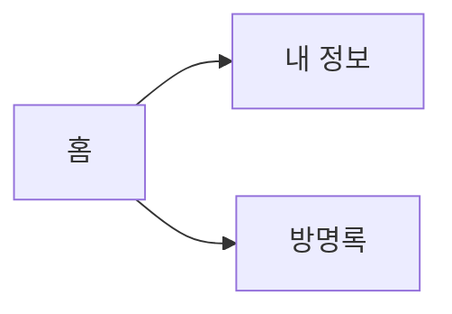

# Markdown and Project 1 Presentation

Day 1 spends the whole day on **Markdown's basic features**. Day 2 is the two-minute Project 1 talk.

```text
Day 1   heading · list · link · emphasis · image · source code · table · quote · SVG diagram · Mermaid
        → README.md first draft introducing your Weeks 3–7 site
Day 2   public URL → three pages → button·form → README·Commits tab (2 min)
```

- The repository is the new `web-week09`; the site files are the Week 7 final, unchanged.
- It is worth **10 points** (talk 5 + report 5). It is not part of the weekly lab score.

---

# Day 1 — Markdown Basics and the README First Draft

`30 min explanation·demo → 60 min lab`

1. ex01 headings and preview · ex02 lists · ex03 links
2. ex04 emphasis
3. ex05 images
4. ex06 source code
5. ex07 tables · ex08 quotes and rules
6. ex09 SVG images · ex10 SVG diagrams · ex11 Mermaid
7. Assembly — `README.md` at the top of `web-week09`

---

## Day 1 · 0–5 min — ex01 Headings: number of hashes and the space

[examples/day1/ex01_heading.md](examples/day1/ex01_heading.md)

```text
Source            Rendered
# 공개 주소       공개 주소       ← 1. one hash: largest heading
## 공개 주소      공개 주소       ← 2. two hashes: one level smaller
#공개 주소        #공개 주소      ← 3. no space: plain text
```

- Markdown is text written with marks; **rendering** reads those marks and draws the shapes.
- In VS Code press **Ctrl+K** then **V** — a preview opens beside the source.

**The number of `#` at the line start sets the heading size. One space after `#`.**

---

## Day 1 · 5–8 min — ex02 Lists: bullets, numbers, nesting, checklists

[examples/day1/ex02_list.md](examples/day1/ex02_list.md)

```text
- 홈              • 홈                ← 1. bullet list
홈 / 내 정보      홈 내 정보          ← 2. no mark: lines join into one paragraph
-홈               -홈                 ← 3. no space: text as is
1. 홈             1. 홈               ← 4. numbered list
  - 이름 칸         ◦ 이름 칸         ← 5. two-space indent: nested list
- [x] 공개 주소   ☑ 공개 주소         ← 6. checklist
```

- A blank line separates paragraphs. Just breaking the line in the source joins them.

**`- ` or `1. ` at the line start makes one list item.**

---

## Day 1 · 8–10 min — ex03 Links: brackets are the text, parentheses the destination

[examples/day1/ex03_link.md](examples/day1/ex03_link.md)

```text
[MDN 웹 문서](https://developer.mozilla.org/ko/)   ← 1. internet address
[ex01 제목 예제](ex01_heading.md)                  ← 2. file in the same folder
[ex01 제목 예제] (ex01_heading.md)                 ← 3. one space off from 2: not a link
```

- Match file names down to upper and lower case. GitHub treats `Home.png` and `home.png` as different files.

**For a file in the same repository, put only its name (path) in the parentheses.**

---

## Day 1 · 10–12 min — ex04 Emphasis: bold, italic, strikethrough

[examples/day1/ex04_emphasis.md](examples/day1/ex04_emphasis.md)

```text
**세 페이지**        세 페이지 (bold)            ← 1
*세 페이지*          세 페이지 (italic)          ← 2
~~세 페이지~~        세 페이지 (strikethrough)   ← 3
**[남기기]**를       **[남기기]**를 (stars stay)  ← 4. punctuation + particle attached
**[남기기]** 를      [남기기] (bold) 를           ← 5. one space fixes it
```

- Number 4 is a trap Korean documents hit often. The stars stay as text, with no error.

**Wrap both sides in the same mark. If stars show, add a space after the closing stars.**

---

## Day 1 · 12–15 min — ex05 Images: an exclamation mark before a link

[examples/day1/ex05_image.md](examples/day1/ex05_image.md)

```text
   ← 1. the image shows in the document
[text to read instead](images/profile.png)    ← 2. no mark: a link to the image
    ← 3. wrong path: text instead of image
             ← 4. img tag to set the size
```

- The bracket text is the same as Week 3 `alt`. It shows when the image does not.
- The path works like Week 3 `images/profile.png`, relative to this file.

**One `!` turns a link into an image.**

---

## Day 1 · 15–18 min — ex06 Source code: backticks

[examples/day1/ex06_code.md](examples/day1/ex06_code.md)

````text
Use `querySelector` in a sentence.       ← 1. one backtick: short code

```js                                    ← 3. language name on the opening line: colors
button.addEventListener('click', …);
```                                      ← forget the closing line and the rest becomes code
````

- Number 2 has no language name, so the code stays one color. Use `js`·`html`·`css`·`bash`.
- Number 4: `#`·`-` inside a code block do not become headings or lists.

**Multi-line code goes between lines of three backticks, with the language on the opening line.**

---

## Day 1 · 18–21 min — ex07 Tables · ex08 Quotes and rules

[examples/day1/ex07_table.md](examples/day1/ex07_table.md) · [examples/day1/ex08_quote_rule.md](examples/day1/ex08_quote_rule.md)

```text
| 페이지 | 파일 |          ← first line is the header
|---|---|                  ← separator line; without it this is plain text
| 홈 | index.html |        ← content
|:---|:---:|---:|          ← colon position: left · center · right alignment

> 새로고침하면 사라진다.   ← quote
---                        ← blank line above: a rule; right under text: that text becomes a heading
```

**A table needs its separator line.**

---

## Day 1 · 21–25 min — ex09·ex10 SVG: images and diagrams written as text

[ex09_svg.md](examples/day1/ex09_svg.md) · [ex09_shapes.svg](examples/day1/ex09_shapes.svg) · [ex10_diagram.md](examples/day1/ex10_diagram.md) · [ex10_site_map.svg](examples/day1/ex10_site_map.svg)

```text
<rect x="20" y="20" width="120" height="60" fill="#e8f1ff" stroke="#3366cc"/>
<line x1="140" y1="50" x2="260" y2="50" stroke="#3366cc"/>
<text x="20" y="120" font-size="20">글자</text>

        ← put it in the document like an image
```

- The numbers are position and size. Edit the file and save, and the preview image changes.
- GitHub removes `<svg>` written directly in a document (ex09 number 2). Add it **as a file**.
- A white background rectangle keeps the text readable on GitHub's dark theme.

**SVG is an image written as text. Rectangles, lines, and text make a diagram.**

---

## Day 1 · 25–27 min — ex11 Mermaid: write only the connections

[examples/day1/ex11_mermaid.md](examples/day1/ex11_mermaid.md)

````text

````

- SVG sets positions by hand; with Mermaid you write **only connections** and GitHub lays them out.
- VS Code's default preview may show this as code. Check it on GitHub after pushing.

**SVG to set positions yourself, Mermaid to draw quickly.**

---

## Day 1 · 27–30 min — Assembly: README first draft, then hand-off to the lab

```text
# site name · intro sentence (**bold**)      ← ex01 · ex04
## 공개 주소   - [URL](URL)                  ← ex02 · ex03
## 페이지      table +   ← ex07 · ex10
## 기능        - two lines + ```js code block ← ex02 · ex06
## 화면         two images ← ex05
## 이번에 배운 것  - three lines             ← ex02
```

[Day 1 lab](lab.md#1일차--마크다운-기본-기능과-readme-1차판-60분) · [Walkthrough](walkthrough.md#1일차) · [Lab page](https://github.com/gbox3d/teaching_repo/tree/main/web_programming/weeks/week09_readme_presentation)

Try values (until minute 35) → screenshots·diagram·README assembly (until minute 50) → new repository `web-week09` · Pages · one screenshot of the repository front page (submit).

**Explanation total: 5+3+2+2+3+3+3+4+2+3 = 30 min**

---

# Day 2 — 2-Minute Talks

`30 min briefing → 60 min talks`

1. Today's order and three tabs
2. The 10-point rubric
3. Watch one 2-minute demo
4. If the public URL does not open
5. Questions, then the talks begin

---

## Day 2 · 0–6 min — Today's Order and Three Tabs

```text
tab 1  https://student01.github.io/web-week09/
tab 2  https://github.com/student01/web-week09          ← front page with the README
tab 3  https://github.com/student01/web-week09/commits  ← Commits tab
```

- Open the three tabs **two speakers before** your turn. Typing addresses counts toward your 2 minutes.
- Start with the guestbook **empty**. Leave one line during the talk.
- If you use dark mode, turn it off first. A light first screen is easier to read.

**Tabs opened in advance give the full 2 minutes to the talk.**

---

## Day 2 · 6–12 min — The 10-Point Rubric

| Talk 5 | Points |
|---|---:|
| The public URL opens | 1 |
| Moves through three pages with nav | 1 |
| Button and form change the screen | 2 |
| Keeps to 2 minutes | 1 |

Report 5 = **1 point for each of the 5 README sections** (public URL / pages / features / screens / what I learned). Details are in the [rubric](rubric.md).

**Where most points are lost: screenshots taken before anything was clicked, and a README copied from the example.**

---

## Day 2 · 12–18 min — Watch One 2-Minute Demo

```text
"student01의 웹 연습장입니다. 세 페이지가 있습니다."   (0:20)
Home → About Me → Guestbook → Home                    (0:50)
click [인사 바꾸기] → sentence and click count change  (1:10)
name & message in the guestbook → [남기기] → one line  (1:30)
empty name → [남기기] → notice sentence                (1:40)
5 README sections → Commits tab briefly                (2:00)
```

- In the first 20 seconds say **what you made** in one sentence. Do not start with "I did HTML, I did CSS…".
- Click while you speak. Explaining after each click doubles the time.

**Show what works first, and click while you speak.**

---

## Day 2 · 18–24 min — If the Public URL Does Not Open

| What happened | What to do |
|---|---|
| Pages still old after 5 min | Local screen + **Commits** tab, same score |
| The public URL is 404 | Check `web-week09`, Pages, `index.html` at top |
| The internet is down | Present later in the order |
| A button does not work | Show what works; explain the cause after |

Do not spend talk time fixing things alone. Raise your hand.

**Failures have a fixed fallback. The time point stays.**

---

## Day 2 · 24–30 min — Questions, Then the Talks Begin

[Day 2 lab](lab.md#2일차--2분-발표-60분) · [Walkthrough](walkthrough.md#2일차) · [Lab page](https://github.com/gbox3d/teaching_repo/tree/main/web_programming/weeks/week09_readme_presentation)

- Questions we take now: order, time, how to submit, what to do if something fails.
- During each talk there is one oral question, e.g. "Which file runs when you press this button?"
- "Does the post disappear on reload?" → "Yes, it is still only on the screen. Keeping it comes in Week 11."
- Listeners follow the rubric too. Fix things during the closing routine at minutes 55–60.

**Total explanation: 6+6+6+6+6 = 30 min**

---

## What to Submit

```text
① 2-minute talk     during the Day 2 class
② public URL        https://student01.github.io/web-week09/
③ repository URL    https://github.com/student01/web-week09
④ one screenshot    repository front page — README 5 sections visible (split into parts if long)
```

Keep your real name, student ID, and real email out of the screenshot. Your ID may show.

---

## Next Week Preview

Right now the guestbook **loses the first post** when you leave a second one, and loses everything on reload.

In Week 10 you start a new repository, `web-week10`, from this week's final files, **stack** posts in an array, draw them as a list, and delete them.
In Week 11 you keep that list in ② browser storage. Today's README is rewritten as the final version in Week 13.
