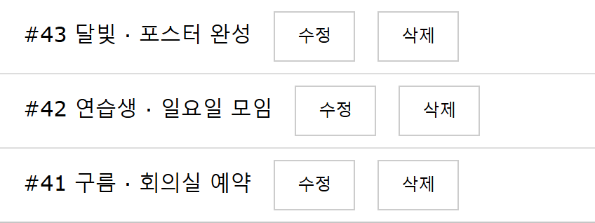

# REST 방명록 CRUD · 토요일 모임을 일요일로

| 순서 | 방명록에서 할 일 | 서버에 보낼 요청 |
|---|---|---|
| Create | ‘토요일 모임’을 저장하고 글 번호를 적는다 | POST |
| Read | 내 태그의 목록에서 그 번호를 찾는다 | GET |
| Update | 같은 글의 내용을 ‘일요일 모임’으로 고친다 | PATCH |
| Delete | 그 글 옆의 **삭제**를 누른다 | DELETE |

수업용 공용 키로 모든 태그의 글을 수정·삭제할 수 있다. 실습에는 자기 태그에 직접 쓴 글을 사용한다.

글을 쓸 때는 브라우저와 REST Client 중 한쪽에서만 전송한다. 두 도구에서 같은 번호를 조회할 수 있다.

[단계별 예제](examples/README.md) · [완성 방명록](examples/day2/web-week13/guestbook.html)

---

## 1일차 · 0–5분 · 수업 API에 접속

예제 폴더를 내려받아 로컬 정적 서버에서 연다. 두 설정 파일에 수업 주소(`API_BASE_URL`), 공개 키(`API_PUBLIC_KEY`), 배정 태그(`BOOK_ID`)를 넣는다.

수업 주소는 `https://esoqbcwgzjtwcqszwvin.supabase.co`다.

| 도구 | 같은 폴더에 만들 설정 파일 |
|---|---|
| 브라우저 | `config.example.json`을 `config.json`으로 복사 |
| VS Code REST Client | `.env.example`을 `.env`로 복사 |

[첫 requests.http](examples/day1/ex01_create/requests.http)를 VS Code에서 열고 각 GET 위의 **Send Request**를 누른다. 두 요청 모두 `apikey` 헤더에 공용 키를 담는다.

- `GET /rest/v1/about` → `200`, 서버 이름과 버전
- `GET /rest/v1/help?order=step.asc` → `200`, 메서드와 경로 목록

---

## 1일차 · 5–20분 · Create · 글 한 건 저장

[생성 화면](examples/day1/ex01_create/index.html)에서 별칭에 ‘연습생’, 메시지에 ‘토요일 모임’을 입력하고 **저장**을 누른다. 폼의 두 값과 설정의 태그를 JSON으로 보낸다.

```js
const response = await fetch(`${API_BASE_URL}/rest/v1/guestbook`, {
  method: 'POST',
  headers: {
    apikey: API_PUBLIC_KEY, 'Content-Type': 'application/json',
    Prefer: 'return=representation'
  },
  body: JSON.stringify({ book_id: BOOK_ID, name, message })
});
```

[같은 POST를 REST Client에서 보기](examples/day1/ex01_create/requests.http)

---

## 1일차 · 20–30분 · 서버가 발급한 글 번호

`Prefer: return=representation`을 보냈으므로 POST의 `201 Created` 응답에는 방금 저장한 행이 들어 있다. 응답에서 읽을 값의 예시는 다음과 같다.

| `book_id` | `id` | `name` | `message` |
|---|---:|---|---|
| student01 | 42 | 연습생 | 토요일 모임 |

```js
const rows = await response.json();
const id = rows[0].id;
```

생성 화면에 **저장 완료 · 글 번호 42 · HTTP 201**처럼 표시된다. 42는 예시다. 화면에 나온 자기 글 번호를 기록한다.

---

## 1일차 · 30–45분 · Read · 태그로 목록 조회

[조회 화면](examples/day1/ex02_read/index.html)에서 **목록 보기**를 누른다. [조회 요청](examples/day1/ex02_read/requests.http)에서 `bookId`는 `.env`의 `BOOK_ID`다.

```http
GET {{baseUrl}}/rest/v1/guestbook?book_id=eq.{{bookId}}&select=id,name,message&order=id.desc
apikey: {{apiKey}}
```

| 조회 조건 | 화면에 미치는 효과 |
|---|---|
| `book_id=eq.student01` | student01 태그의 글만 보인다 |
| `select=id,name,message` | 번호·별칭·메시지를 받는다 |
| `order=id.desc` | 큰 번호부터 보인다 |

---

## 1일차 · 45–55분 · 응답의 한 행을 목록의 한 줄로

`200 OK` 응답의 배열을 순회한다. 화면의 `#42`는 서버가 돌려준 `row.id`다.

```js
for (const row of rows) {
  const item = document.createElement('li');
  item.textContent = `#${row.id} ${row.name} · ${row.message}`;
  entries.append(item);
}
```

조회 화면을 새로고침하고 **목록 보기**를 다시 누른다. `#42 연습생 · 토요일 모임`처럼 같은 줄이 돌아온다. 글이 보이지 않으면 생성·조회 폴더의 `BOOK_ID`를 대조한다.

---

## 1일차 · 55–60분 · 실습 안내

| 실습 30분 | 할 일 | 남길 결과 |
|---|---|---|
| 0–5분 | 소개와 도움말에 **Send Request** | 두 요청의 `200 OK` |
| 5–15분 | 생성 화면에서 ‘토요일 모임’ 저장 | POST가 발급한 내 글 번호 |
| 15–30분 | 조회 화면을 새로고침하고 **목록 보기** | 그 번호 옆의 별칭과 원문 |

2일차에 이 글을 고친다. 오늘은 조회한 상태로 둔다.

[1일차 실습지](lab.md#1일차-실습) · [브라우저와 REST Client 설정](walkthrough.md#2-rest-client와-브라우저-설정)

---

## 2일차 · 0–5분 · 수정할 글 선택

[수정 화면](examples/day2/ex03_update/index.html)의 **수정할 글** 목록에서 어제 기록한 번호를 고른다. **새 메시지**에 ‘일요일 모임’을 입력한다.

| 주소의 조건 예시 | 선택되는 대상 |
|---|---|
| `book_id=eq.student01` | student01 방명록의 글 |
| `book_id=eq.student01&id=eq.42` | 그 방명록에서 번호가 42인 글 |

목록에서 선택한 번호는 주소에 넣는다. 새 문장은 요청 본문에 넣는다.

---

## 2일차 · 5–20분 · Update · 메시지 한 칸 수정

**수정**을 누르면 선택한 번호로 PATCH를 보낸다. [수정 요청 파일](examples/day2/ex03_update/requests.http)에서는 **Send Request**를 누른 뒤 입력창에 자기 글 번호를 넣는다.

```http
PATCH {{baseUrl}}/rest/v1/guestbook?book_id=eq.{{bookId}}&id=eq.{{entryId}}
apikey: {{apiKey}}
Content-Type: application/json
Prefer: return=representation

{ "message": "일요일 모임" }
```

별칭은 그대로 두고 메시지만 바꾸므로 JSON에는 `message`만 담는다.

---

## 2일차 · 20–30분 · 수정 결과를 같은 번호로 조회

[수정 요청 파일](examples/day2/ex03_update/requests.http)에서 PATCH 아래의 GET에도 같은 번호를 입력한다.

| 확인할 때 | 번호 | 메시지 |
|---|---:|---|
| 처음 저장한 글 | 42 | 토요일 모임 |
| PATCH 응답 배열의 행 | 42 | 일요일 모임 |
| 같은 주소를 GET한 결과 | 42 | 일요일 모임 |

PATCH가 `200 OK`여도 응답이 `[]`이면 수정된 행은 0개다. 태그와 글 번호를 확인하고 해당 주소를 GET한다.

---

## 2일차 · 30–45분 · Delete · 글 옆의 삭제 버튼

[삭제 화면](examples/day2/ex04_delete/index.html)은 열자마자 목록을 읽고 각 글 옆에 버튼을 붙인다. 각 버튼에는 **그 행의 번호**가 연결된다.

```js
button.addEventListener('click', function () {
  deleteEntry(row.id, item, button);
});
```

‘일요일 모임’ 옆의 **삭제**를 누르면 ‘글 42번을 삭제하시겠습니까?’처럼 번호가 뜬다. 취소하면 요청을 보내지 않는다. 확인하면 해당 태그와 번호를 주소에 넣어 DELETE를 보낸다.

[DELETE 요청 열기](examples/day2/ex04_delete/requests.http)

---

## 2일차 · 45–55분 · 삭제한 번호를 다시 조회

브라우저에서 삭제했다면 [요청 파일](examples/day2/ex04_delete/requests.http)에서 **GET만** 실행한다. REST Client로 실습할 때는 DELETE → GET 순서로 보내고 두 요청에 같은 번호를 넣는다.

| 요청 | 응답 예시 | 읽을 값 |
|---|---|---|
| DELETE | `204 No Content` | 본문이 없어 JSON을 읽지 않는다 |
| GET | `200 OK`와 `[]` | 이 태그와 번호에 해당하는 글이 없다 |

브라우저 예제도 같은 번호로 GET한 뒤 결과가 비었을 때 해당 줄을 지운다. 글이 남아 있으면 목록에 그대로 표시한다.

---

## 2일차 · 55–60분 · 실습 안내

| 실습 30분 | 할 일 | 남길 결과 |
|---|---|---|
| 0–10분 | ‘토요일 모임’을 ‘일요일 모임’으로 수정 | 처음 기록한 번호 |
| 10–15분 | 수정한 번호를 GET | 새 문장이 담긴 행 |
| 15–30분 | 해당 줄의 삭제를 취소한 뒤 다시 눌러 확인 | 삭제 뒤 같은 번호의 GET 결과 `[]` |

[2일차 실습지](lab.md#2일차-실습) · [삭제 화면](examples/day2/ex04_delete/index.html)

---

# 완성 방명록에서 한 글을 끝까지

저장한 뒤 목록 보기를 누른다. ‘수정할 내용’에 ‘일요일 모임’을 쓰고 내 글 옆의 **수정**을 누른다. 그 줄의 **삭제**를 누르면 글 번호를 확인할 수 있다.



[완성 방명록](examples/day2/web-week13/guestbook.html) · [완성본 requests.http](examples/day2/web-week13/requests.http)

14주에는 글 세 개 중 가운데 하나를 지우고, 남은 두 글의 번호도 확인한다.
