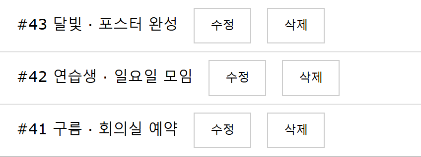

# Guestbook CRUD · Change the meeting day

| Step | Action in the guestbook | HTTP method |
|---|---|---|
| Create | Save “토요일 모임” (Saturday meeting) and record its ID | POST |
| Read | Find that ID in the list for your tag | GET |
| Update | Change the message to “일요일 모임” (Sunday meeting) | PATCH |
| Delete | Click **삭제** beside that entry | DELETE |

The shared classroom key can update and delete entries under any tag. Work with an entry you wrote under your assigned tag.

Send each write once, from either the browser or REST Client. Both tools can read the same entry.

[Four examples](examples/README.md) · [Complete guestbook](examples/day2/web-week13/guestbook.html)

---

## Day 1 · 0–5 min · Connect to the class API

Download the example folder and serve it locally. Set the class URL (`API_BASE_URL`), publishable key (`API_PUBLIC_KEY`) and assigned tag (`BOOK_ID`) in both files.

The class URL is `https://esoqbcwgzjtwcqszwvin.supabase.co`.

| Tool | File to create in the example folder |
|---|---|
| Browser | Copy `config.example.json` to `config.json` |
| VS Code REST Client | Copy `.env.example` to `.env` |

Open the [first requests.http](examples/day1/ex01_create/requests.http) in VS Code. Click **Send Request** above each GET. Both send the shared key in the `apikey` header.

- `GET /rest/v1/about` → `200`, server name and version
- `GET /rest/v1/help?order=step.asc` → `200`, list of methods and paths

---

## Day 1 · 5–20 min · Create one entry

On the [create page](examples/day1/ex01_create/index.html), enter “연습생” as the alias and “토요일 모임” as the message. Click **저장** (Save). The form values and the tag go into the JSON body.

```js
const response = await fetch(`${API_BASE_URL}/rest/v1/guestbook`, {
  method: 'POST',
  headers: {
    apikey: API_PUBLIC_KEY, 'Content-Type': 'application/json',
    Prefer: 'return=representation'
  },
  body: JSON.stringify({ book_id: BOOK_ID, name, message })
});
```

[Open the matching POST request](examples/day1/ex01_create/requests.http)

---

## Day 1 · 20–30 min · Read the ID assigned by the server

With `Prefer: return=representation`, the `201 Created` response contains the saved row. Here are four of its fields.

| `book_id` | `id` | `name` | `message` |
|---|---:|---|---|
| student01 | 42 | 연습생 | 토요일 모임 |

```js
const rows = await response.json();
const id = rows[0].id;
```

The create page shows a message like **저장 완료 · 글 번호 42 · HTTP 201**. Here 42 is an example. Record the ID from your own screen.

---

## Day 1 · 30–45 min · Read the list for one tag

Click **목록 보기** (View list) on the [read page](examples/day1/ex02_read/index.html). In the [GET request](examples/day1/ex02_read/requests.http), `bookId` comes from `BOOK_ID` in `.env`.

```http
GET {{baseUrl}}/rest/v1/guestbook?book_id=eq.{{bookId}}&select=id,name,message&order=id.desc
apikey: {{apiKey}}
```

| Query parameter | What the page receives |
|---|---|
| `book_id=eq.student01` | Entries tagged student01 |
| `select=id,name,message` | The ID, alias and message |
| `order=id.desc` | Highest ID first |

---

## Day 1 · 45–55 min · Display one list item per row

Loop over the array in the `200 OK` response. The page gets the number in `#42` from the server’s `row.id`.

```js
for (const row of rows) {
  const item = document.createElement('li');
  item.textContent = `#${row.id} ${row.name} · ${row.message}`;
  entries.append(item);
}
```

Refresh and click **목록 보기** again. Look for the same line, such as `#42 연습생 · 토요일 모임`. If the entry is missing, compare `BOOK_ID` in the create and read folders.

---

## Day 1 · 55–60 min · Lab instructions

| Lab time | Action | Result to record |
|---|---|---|
| 0–5 min | Click **Send Request** for about and help | Two `200 OK` responses |
| 5–15 min | Save “토요일 모임” on the create page | The ID assigned by POST |
| 15–30 min | Refresh the read page and click **목록 보기** | The alias and original message beside that ID |

Keep the entry for the next session.

[Day 1 lab](lab.md#1일차-실습) · [Browser and REST Client setup](walkthrough.md#2-rest-client와-브라우저-설정)

---

## Day 2 · 0–5 min · Choose the entry to update

On the [update page](examples/day2/ex03_update/index.html), select the ID you recorded under **수정할 글** (Entry to edit). Enter “일요일 모임” under **새 메시지** (New message).

| Example filter | Rows selected |
|---|---|
| `book_id=eq.student01` | Entries in the student01 book |
| `book_id=eq.student01&id=eq.42` | Entry 42 in that book |

Put the selected ID in the URL. Put the new message in the body.

---

## Day 2 · 5–20 min · Update the message

Click **수정** (Update) to send a PATCH for the selected ID. In the [request file](examples/day2/ex03_update/requests.http), click **Send Request**, then enter your entry ID when prompted.

```http
PATCH {{baseUrl}}/rest/v1/guestbook?book_id=eq.{{bookId}}&id=eq.{{entryId}}
apikey: {{apiKey}}
Content-Type: application/json
Prefer: return=representation

{ "message": "일요일 모임" }
```

The alias stays the same. The JSON body contains only `message`.

---

## Day 2 · 20–30 min · Read the updated entry

Open the [update request file](examples/day2/ex03_update/requests.http) and enter the same ID for the GET below the PATCH.

| Stage | ID | Message |
|---|---:|---|
| Original entry | 42 | 토요일 모임 |
| Row in the PATCH response | 42 | 일요일 모임 |
| GET for the same URL | 42 | 일요일 모임 |

A PATCH can return `200 OK` with `[]`. In that case it updated zero rows. Check the tag and ID, then send a GET to that URL.

---

## Day 2 · 30–45 min · Delete from the row

The [delete page](examples/day2/ex04_delete/index.html) loads the list when it opens. It gives each row a **삭제** (Delete) button that uses **that row’s ID**.

```js
button.addEventListener('click', function () {
  deleteEntry(row.id, item, button);
});
```

Click **삭제** beside “일요일 모임”. The dialog names the ID, for example “글 42번을 삭제하시겠습니까?” Cancel sends no request. Confirm sends a DELETE with the tag and ID in the URL.

[Open the DELETE request](examples/day2/ex04_delete/requests.http)

---

## Day 2 · 45–55 min · Read the deleted ID again

If you deleted the entry in the browser, run **only the GET** in the [request file](examples/day2/ex04_delete/requests.http). For a REST Client lab, send DELETE and then GET, using the same ID for both.

| Request | Example response | What to read |
|---|---|---|
| DELETE | `204 No Content` | The body is empty. Skip JSON parsing. |
| GET | `200 OK` and `[]` | No entry matches this tag and ID. |

The browser example also sends a GET for the same ID. It removes the list item when the array is empty. If a row comes back, it stays on screen.

---

## Day 2 · 55–60 min · Lab instructions

| Lab time | Action | Result to record |
|---|---|---|
| 0–10 min | Change “토요일 모임” to “일요일 모임” | The original ID |
| 10–15 min | Send a GET for the updated ID | The row with the new message |
| 15–30 min | Cancel the row’s delete, then click it again and confirm | `[]` from a GET for the same ID |

[Day 2 lab](lab.md#2일차-실습) · [Delete page](examples/day2/ex04_delete/index.html)

---

# One entry in the complete guestbook

Save and click 목록 보기 (View list). Enter “일요일 모임” under 수정할 내용, then click **수정** beside your ID. To remove it, click **삭제** on that row and confirm its ID.



[Complete guestbook](examples/day2/web-week13/guestbook.html) · [Complete requests.http](examples/day2/web-week13/requests.http)

In week 14, delete the middle of three entries and check the IDs of the two that remain.
